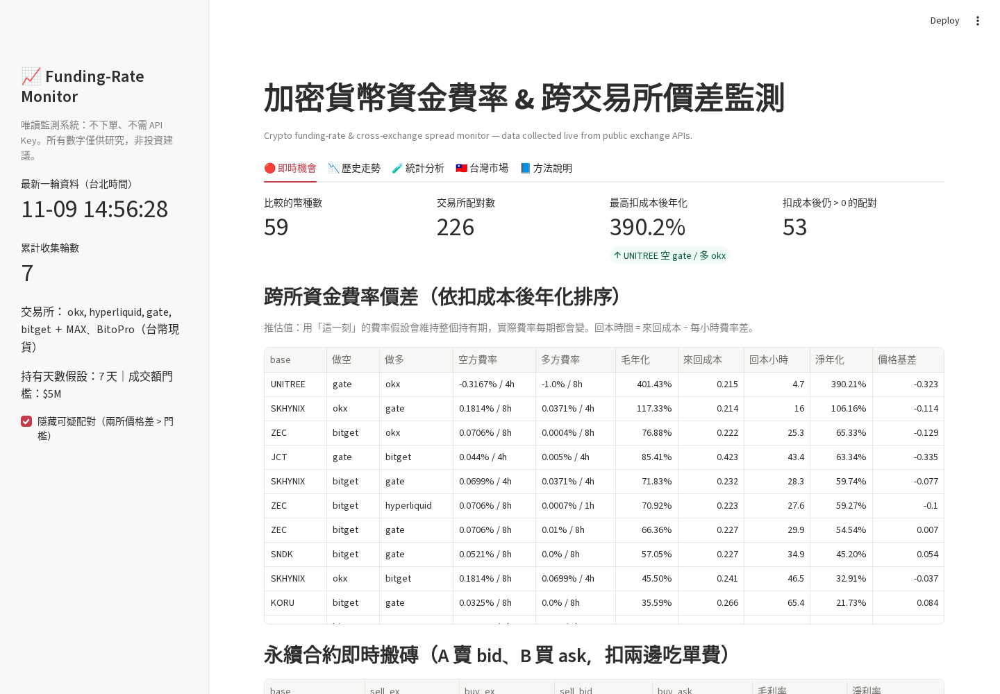
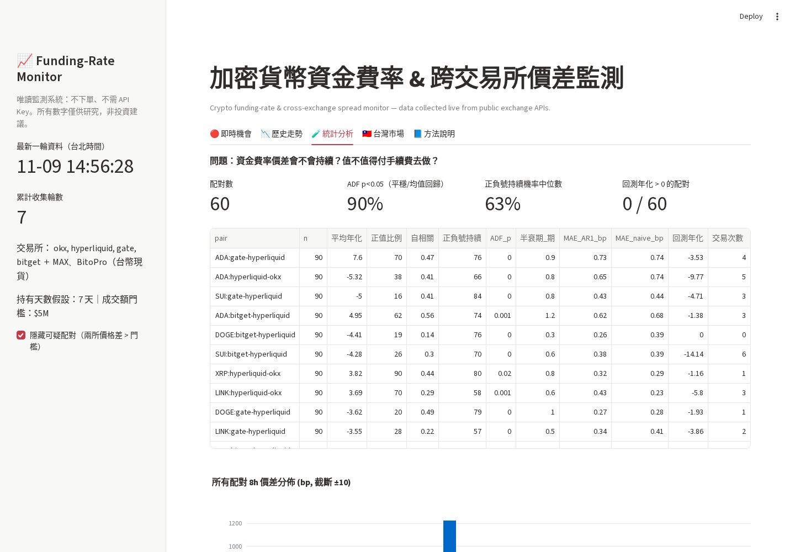
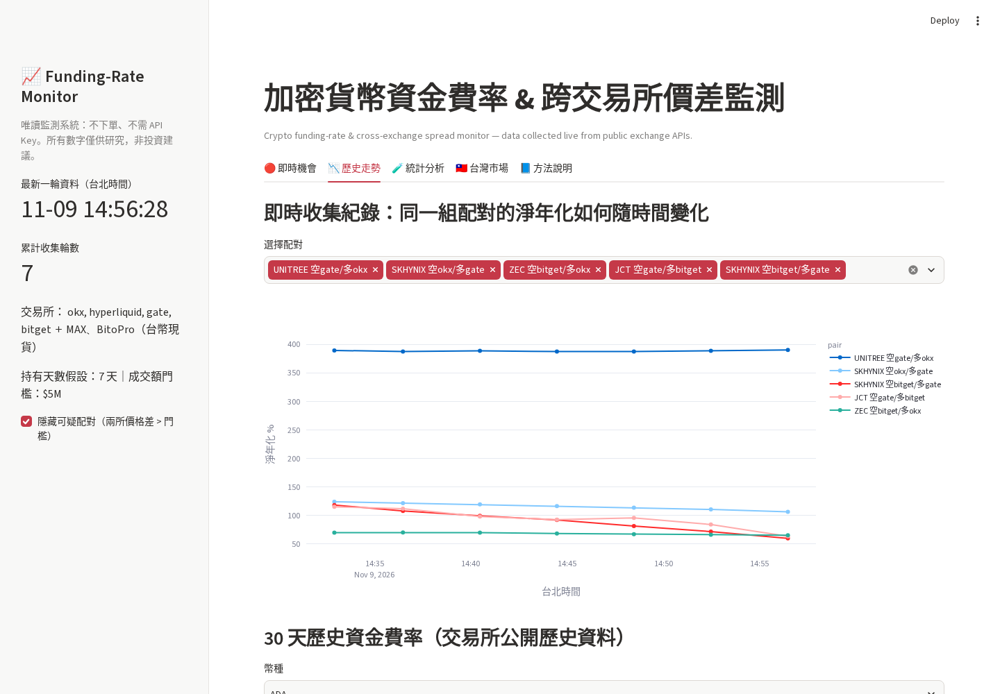
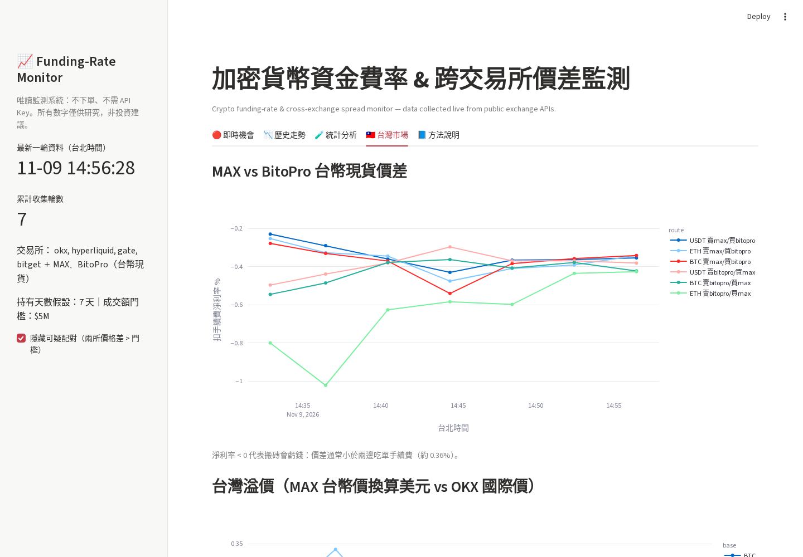
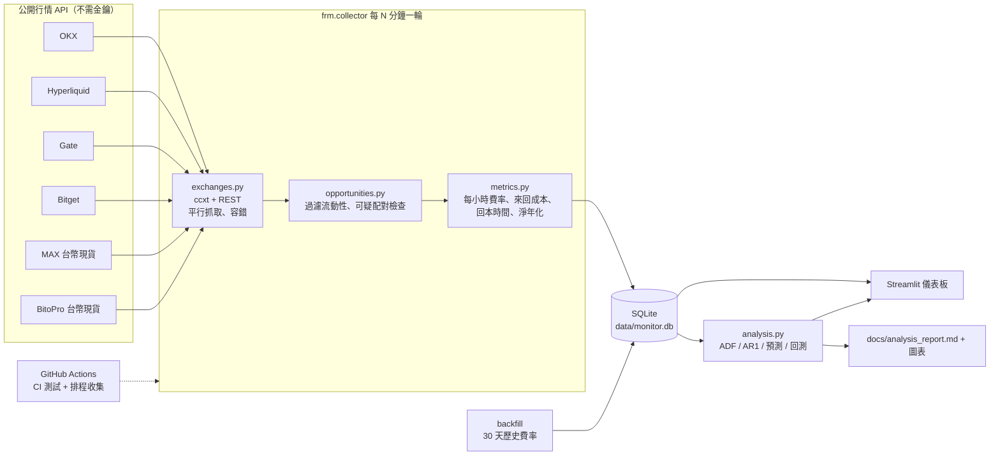

# 📈 Funding-Rate Monitor｜加密貨幣資金費率與跨交易所價差監測系統

   

> **English summary** — A read-only data system that collects live perpetual-futures funding rates and top-of-book quotes from
> 4 exchanges (OKX, Hyperliquid, Gate, Bitget) plus TWD spot quotes from 2 Taiwanese exchanges (MAX, BitoPro) every few minutes,
> computes **fee-adjusted** cross-exchange funding carry, break-even holding time and instant price arbitrage, stores everything in SQLite,
> and runs a statistical study (ADF stationarity test, AR(1) half-life, out-of-sample forecasting, cost-aware backtest) on 30 days of
> historical funding data to answer one question: **do funding-rate spreads persist long enough to pay for trading costs?**
> Includes a 5-tab Streamlit dashboard, pytest suite, GitHub Actions CI and an optional scheduled collector. No API keys, no trading.

**作者**：馬瑞隆｜**開發協助**：AI coding agent（見下方〈誠實聲明〉）

---

## 這個專案在回答什麼問題？

網路上常說「跨交易所資金費率套利 = 穩賺的被動收入」。但真的嗎？
1. 扣掉 **4 筆成交手續費 + 買賣價差** 之後還剩多少？
2. 看到的高費率差，**會持續到回本**，還是幾小時就消失？
3. 台灣的交易所（MAX、BitoPro）之間搬磚、或跟國際市場比，有沒有價差可吃？

本系統用**真實即時資料 + 30 天歷史資料 + 統計檢定**回答這三題，而不是用單一截圖下結論。

## 截圖

| 即時機會 | 統計分析 |
|---|---|
|  |  |
| **歷史走勢** | **台灣市場** |
|  |  |

## 系統架構



## 功能

- **即時收集**：每輪約 15 秒抓完 4 家永續交易所「全部」USDT/USDC 永續（約 2,700 個市場）的資金費率與最佳買賣價，加上 MAX / BitoPro 台幣報價。
- **成本精算**：不同結算週期（1h / 4h / 8h）統一換算成每小時；成本 = 4 筆吃單手續費 + 兩邊買賣價差；算出**回本小時數**與**扣成本後年化**。
- **資料品質檢查**：兩所價格差 > 2% 自動標為「可疑」（實際抓到過盤前 / 股票代幣類合約在兩所定義不同、價差 3%+ 的假機會）。
- **台灣市場**：MAX ↔ BitoPro 雙向搬磚淨利率、「台灣溢價」（MAX 的 BTC/TWD 換算美元 vs 國際價）。
- **統計分析**：價差分佈、lag-1 自相關、正負號持續機率、ADF 平穩性檢定、AR(1) 半衰期、樣本外預測（AR(1) vs naive）、扣費回測。
- **儀表板**：Streamlit 5 個分頁，所有時間以台北時間顯示。
- **工程實務**：設定檔驅動、SQLite WAL、純函式 + 31 個 pytest 測試、GitHub Actions CI（Python 3.11/3.12）、選用的排程收集 workflow。

## 快速開始

```bash
git clone <this repo> && cd funding-rate-monitor
python -m venv .venv && source .venv/bin/activate        # Windows: .venv\Scripts\activate
pip install -r requirements-dev.txt

python -m frm.collector once                  # 抓一輪即時資料
python -m frm.collector loop --cycles 12      # 每 5 分鐘一輪，共 12 輪（不加 --cycles 就一直跑）
python -m frm.collector backfill --days 30    # 抓 30 天歷史資金費率
python -m frm.analysis report                 # 產生統計報告 docs/analysis_report.md
streamlit run app/streamlit_app.py            # 開啟儀表板 http://localhost:8501
python -m pytest                              # 跑測試（不需網路）
python scripts/summarize_results.py           # 把實測數字整理成 docs/live_results.md
```

所有參數（交易所、手續費、成交額門檻、持有天數…）都在 [`config.yaml`](config.yaml)。

> ⚠️ Binance、Bybit 的 API 在部分地區（含美國雲端機房、GitHub Actions）會回傳地區限制錯誤，因此預設不啟用；在台灣本機可自行加入 `perp_exchanges`。

## 專案結構

```
frm/
  config.py         設定檔讀取
  symbols.py        幣種名稱正規化（1000PEPE / kPEPE → PEPE）
  metrics.py        純數學：年化、來回成本、回本時間、淨年化
  exchanges.py      交易所資料抓取（唯一有網路 I/O 的模組）
  opportunities.py  機會計算與資料品質檢查
  storage.py        SQLite 儲存
  collector.py      主程式（once / loop / backfill）
  analysis.py       統計分析與報告
app/streamlit_app.py  儀表板
tests/              pytest 單元測試（+ 選用的連網整合測試）
scripts/            截圖、結果摘要
.github/workflows/  CI 與排程收集
docs/               截圖、圖表、分析報告、實測結果
```

## 核心公式

| 項目 | 公式 |
|---|---|
| 每小時費率 | 本期費率 ÷ 結算週期（小時） |
| 毛年化 | (空方每小時 − 多方每小時) × 8760 |
| 來回成本 | 2 × (多方吃單費 + 空方吃單費) + Σ 兩邊 (ask − bid)/mid |
| 回本時間 | 來回成本 ÷ 每小時費率差 |
| 淨年化 | 毛年化 − 來回成本 × 365 ÷ 持有天數（預設 7 天） |
| 即時搬磚淨利率 | A 的 bid ÷ B 的 ask − 1 − A 吃單費 − B 吃單費 |

<!-- RESULTS:START -->
## 結果（Results）

### ✅ 實測（Measured）— 2026-11-09 14:32 ~ 14:56（台北時間）實際跑 7 輪、0 錯誤，每輪約 11 秒
完整表格：[docs/live_results.md](docs/live_results.md)｜統計報告：[docs/analysis_report.md](docs/analysis_report.md)

- **扣成本後年化最高的配對**都集中在非主流 / 股票代幣類合約：UNITREE（空 Gate / 多 OKX）約 388% 年化、回本約 5 小時；SKHYNIX、JCT、ZEC 在 7 輪中都持續留在前 10 名。這些市場流動性低、費率常觸及上下限，風險很高。
- **主流幣幾乎不划算**：BTC 最佳配對毛年化僅 1.5%，扣成本後 −8.7%，回本中位數約 1,700 小時；ETH / SOL 扣成本後僅約 4–5%。
- **永續即時搬磚**：扣吃單費後淨利率 > 0 的比例只有 2.1%，且多出現在低流動性合約。
- **MAX ↔ BitoPro 台幣搬磚**：42 次觀測中 0 次扣費後有利潤（最佳毛利 0.131%，扣費後 −0.229%）。
- **台灣溢價**：BTC 平均 +0.048%、ETH 平均 +0.177%（MAX 換算美元 vs OKX）。

### 📊 歷史資料統計（Historical, 30 天公開歷史資金費率，10 個主流幣 × 4 家交易所 = 60 組配對）
- 54/60 組價差 ADF p < 0.05 → 多半是平穩、會均值回歸的序列；AR(1) 半衰期多在 1 期（8 小時）以內。
- 正負號持續機率中位數 63%、lag-1 自相關中位數 0.35：有一點持續性，但不強。
- 成本感知回測：38 組有交易，**0 組扣費後為正**。主流幣價差平均約年化 1.5%，遠小於約 0.19% 的一次來回成本攤提。

### 🔮 推估（Estimates，非實測）
- 儀表板上的「淨年化」假設當下費率會維持整個持有期（預設 7 天），實際每期都會變，屬於**推估**。
- 未計入：大額滑價、兩所轉帳時間與費用、保證金占用、爆倉與交易所風險。

**結論**：在主流幣上，跨所資金費率套利扣完成本後不成立；看起來誘人的機會集中在高風險、低流動性合約。這個系統的價值在於**用數據把這件事證明出來**，並能持續監測是否出現例外。
<!-- RESULTS:END -->

## 開源引用與授權（Attribution）

本專案以 MIT 授權釋出。使用 / 參考的開源專案：

| 專案 | 授權 | 怎麼用 | 修改內容 |
|---|---|---|---|
| [ccxt/ccxt](https://github.com/ccxt/ccxt) | MIT | 函式庫依賴，統一 4 家交易所 API | 未修改；另外處理各所欄位不一致（OKX 成交量單位、Bitget 結算週期在市場資訊裡） |
| [hamood1337/CryptoFundingArb](https://github.com/hamood1337/CryptoFundingArb) | MIT | 改寫 `symbols.py`（乘數正規化）與 `funding.py`/`fees.py` 的年化、四筆來回成本、回本概念 | 改以每小時為單位；加入盤口價差成本、即時搬磚、可疑配對檢查；回本改以小時計 |
| [supervik/funding-rate-arbitrage-scanner](https://github.com/supervik/funding-rate-arbitrage-scanner) | **無授權** | 只參考 README 的分析概念（perp-perp 配對、歷史平均年化） | **未使用任何程式碼**（無授權 = 保留所有權利） |

完整授權文字見 [THIRD_PARTY_NOTICES.md](THIRD_PARTY_NOTICES.md)。

**我自己（原創）的部分**：SQLite 歷史資料層與排程收集、台灣交易所（MAX / BitoPro）整合與台灣溢價、資料品質檢查、整個統計分析模組（ADF、AR(1) 半衰期、樣本外預測、成本感知回測）、Streamlit 儀表板、測試與 CI。

## 誠實聲明

- 本專案在 AI coding agent 協助下完成。我負責選題、方向與驗收，並透過 [LEARN.md](LEARN.md) 逐檔學習程式邏輯；每條公式都有手算驗證的測試。
- **唯讀系統**：不下單、不需要 API Key、不碰任何資金。所有數字僅供研究，**不是投資建議**。

## Roadmap 未來方向

- [ ] 長期資料：用排程收集 2–4 週即時資料，以「真實即時快照」重做持續性分析（目前持續性結論主要來自 30 天歷史費率）
- [ ] 加入下單深度（order book depth）估算大額滑價，而不只看第一檔
- [ ] Telegram / Discord 通知：淨年化 > 門檻且連續 N 輪出現時推播
- [ ] 預測模型升級：加入成交量、未平倉量、基差等特徵，比較 AR / 梯度提升樹
- [ ] 現貨-永續（同所）套利、借貸利率比較
- [ ] 部署：Streamlit Community Cloud（儀表板）＋ GitHub Actions 或雲端主機（收集器）
