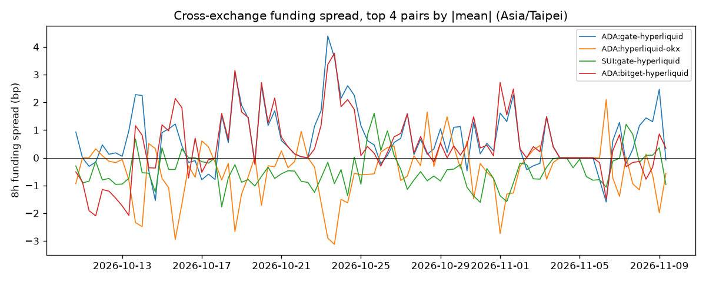
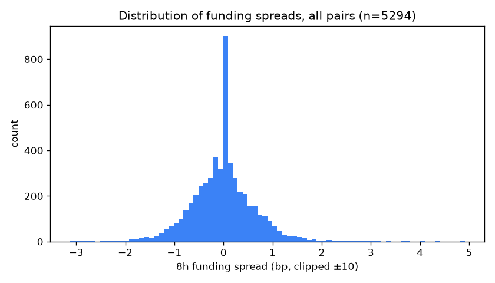
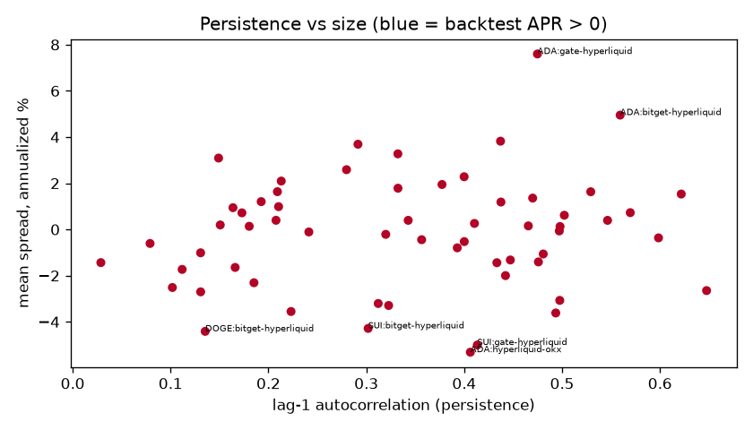

# 統計分析報告 Analysis Report

> 本報告由 `python -m frm.analysis report` 自動產生。歷史資料 = 交易所公開 API 的實際歷史資金費率；
> 回測（backtest）= 用歷史資料模擬，**不是實盤績效**，未計滑價、資金占用、轉帳與爆倉風險。

## 1. 歷史資金費率價差（2026-10-10 15:00 ~ 2026-11-09 14:00，台北時間）

幣種 10 個、交易所 4 家、交易所配對 60 組，每期 = 8 小時。

| 配對 (A−B) | 期數 | 平均年化 | 正值比例 | lag-1 自相關 | 正負號持續 | ADF p | 半衰期(期) | MAE AR1 / naive | 回測年化 (交易次數) |
|---|---|---|---|---|---|---|---|---|---|
| ADA:gate-hyperliquid | 90 | 7.60% | 70% | 0.47 | 76% | 0.000 | 0.9 | 0.73 / 0.74 bp | -3.53% (4) |
| ADA:hyperliquid-okx | 90 | -5.32% | 38% | 0.41 | 66% | 0.000 | 0.8 | 0.65 / 0.74 bp | -9.77% (5) |
| SUI:gate-hyperliquid | 90 | -5.00% | 16% | 0.41 | 84% | 0.000 | 0.8 | 0.43 / 0.44 bp | -4.71% (3) |
| ADA:bitget-hyperliquid | 90 | 4.95% | 62% | 0.56 | 74% | 0.001 | 1.2 | 0.62 / 0.68 bp | -1.38% (3) |
| DOGE:bitget-hyperliquid | 90 | -4.41% | 19% | 0.14 | 76% | 0.000 | 0.3 | 0.26 / 0.39 bp | 0.00% (0) |
| SUI:bitget-hyperliquid | 90 | -4.28% | 26% | 0.30 | 70% | 0.000 | 0.6 | 0.38 / 0.39 bp | -14.14% (6) |
| XRP:hyperliquid-okx | 90 | 3.82% | 90% | 0.44 | 80% | 0.020 | 0.8 | 0.32 / 0.29 bp | -1.16% (1) |
| LINK:hyperliquid-okx | 90 | 3.69% | 70% | 0.29 | 58% | 0.001 | 0.6 | 0.43 / 0.23 bp | -5.80% (3) |
| DOGE:gate-hyperliquid | 90 | -3.62% | 20% | 0.49 | 79% | 0.000 | 1.0 | 0.27 / 0.28 bp | -1.93% (1) |
| LINK:gate-hyperliquid | 90 | -3.55% | 28% | 0.22 | 57% | 0.000 | 0.5 | 0.34 / 0.41 bp | -3.86% (2) |
| LINK:bitget-hyperliquid | 90 | -3.29% | 34% | 0.32 | 65% | 0.000 | 0.6 | 0.50 / 0.55 bp | -6.07% (3) |
| SUI:hyperliquid-okx | 90 | 3.27% | 80% | 0.33 | 78% | 0.000 | 0.6 | 0.42 / 0.44 bp | -5.84% (3) |
| XRP:bitget-hyperliquid | 90 | -3.21% | 14% | 0.31 | 81% | 0.000 | 0.6 | 0.30 / 0.24 bp | 0.00% (0) |
| DOGE:hyperliquid-okx | 90 | 3.09% | 78% | 0.15 | 70% | 0.000 | 0.4 | 0.32 / 0.41 bp | -1.53% (1) |
| SOL:gate-hyperliquid | 90 | -3.07% | 21% | 0.50 | 80% | 0.000 | 1.0 | 0.42 / 0.39 bp | -4.39% (2) |

**解讀（自動計算）**

- 54/60 組配對的 ADF p < 0.05 → 價差大多是「平穩、會回到平均」的序列。
- 正負號持續機率中位數 63%，lag-1 自相關中位數 0.35。
- AR(1) 樣本外誤差比 naive 小的配對：35/60。
- 簡單 carry 策略回測：有交易的配對 38/60，其中年化 > 0 的 0 組（扣 taker 手續費後）。
- 全部配對的平均價差絕對值中位數只有 1.49%/年，而一次來回手續費約 0.19%：主流幣的價差通常太小。

## 2. 即時收集（collector）實測：7 輪，2026-11-09 14:32 ~ 14:56 台北時間

每一輪「扣成本後年化」前 10 名中，重複出現的組合（出現越多輪越持續）：

| 幣 | 做空 | 做多 | 出現輪數 | 平均淨年化 | 最低 / 最高 | 回本時間中位數 |
|---|---|---|---|---|---|---|
| UNITREE | gate | okx | 7 | 388.43% | 387.34% / 390.21% | 4.8 h |
| SKHYNIX | okx | gate | 7 | 115.94% | 106.16% / 124.03% | 14.8 h |
| JCT | gate | bitget | 7 | 94.37% | 63.34% / 115.17% | 26.1 h |
| SKHYNIX | bitget | gate | 7 | 89.99% | 59.74% / 118.21% | 19.4 h |
| ZEC | bitget | okx | 7 | 68.08% | 65.33% / 70.00% | 24.8 h |
| ZEC | bitget | hyperliquid | 7 | 66.43% | 59.27% / 73.13% | 25.7 h |
| ZEC | bitget | gate | 7 | 52.03% | 50.42% / 54.54% | 31.2 h |
| SNDK | bitget | gate | 7 | 46.84% | 45.20% / 49.05% | 35.9 h |
| CL | bitget | okx | 6 | 22.82% | 21.01% / 24.64% | 58.0 h |
| SNDK | okx | gate | 5 | 20.35% | 19.49% / 21.24% | 61.2 h |
